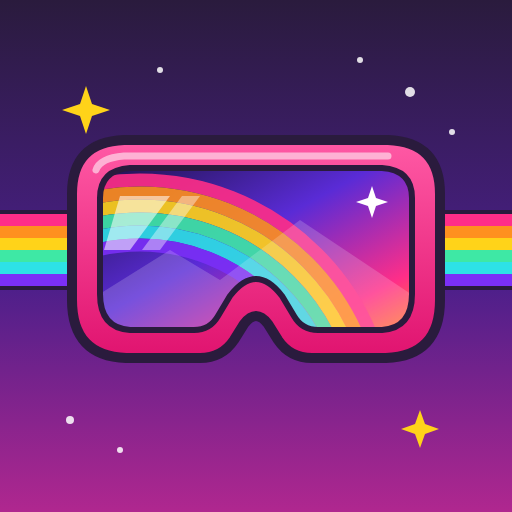

# Lord of the Board

Retro snowboardowy slalom w klimacie lat 80. i 90.: neonowe kolory, duże piksele, przewijany pionowo stok jak w River Raid i syntezatorowa muzyczka.

## Jak się gra
- **Start:** po odliczaniu stuknij **3×**. Liczy się tempo stukania: szybsze odepchnięcie to większa prędkość na starcie.
- **Skręt:** przechylasz telefon, a deska skręca maksymalnie o około 55°. Zjazd się nie zatrzymuje, od band po bokach tylko się odbijasz.
- **Drift:** przy dużej prędkości tor jazdy nie nadąża za deską. Wtedy deska ślizga się bokiem, sypie śniegiem i trochę hamuje.
- **Bramki:** przejedź między słupkami. Ominięta bramka to **+2 s**. Kolejne trafione bramki budują combo, a dźwięk idzie coraz wyżej.
- **Skoki:** trzymanie skrętu w locie kręci obrót. Po puszczeniu deska sama ustawia się do lądowania. Ląduj prosto, a każde 180° daje **−0,5 s**.
- **Pauza:** stuknij w ekran (przy sterowaniu dotykiem stuknij górną część ekranu).

## Tryby
- **Solo:** trzy trasy. Gra zapamiętuje rekord, a obok jedzie duch Twojego najlepszego przejazdu.
- **2 graczy (split screen):** P1 steruje A/D i odpycha się W, P2 używa ←/→ i ↑. Na telefonie każdy gracz trzyma lewą albo prawą część swojej połówki ekranu.
- **Online:** jeden gracz tworzy pokój, drugi wpisuje 4‑cyfrowy kod albo otwiera link. Połączenie działa jak w Gravity Ball: trzy publiczne serwery MQTT naraz.

## Uruchomienie
Cała gra to jeden plik `index.html` bez budowania. Na GitHub Pages działa od razu: Settings → Pages → `main` / root. Na iPhonie dodaj grę do ekranu początkowego i zgódź się na dostęp do czujnika ruchu.

Ikona jest w `icon.svg` (gogle z tęczowym paskiem i odbiciem), a pliki PNG są z niej wygenerowane.
